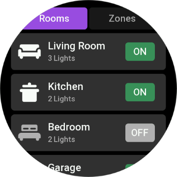
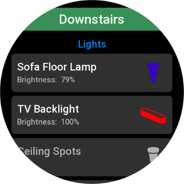
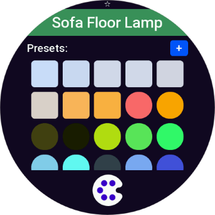
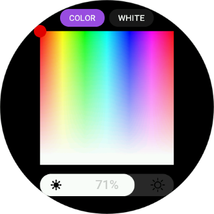
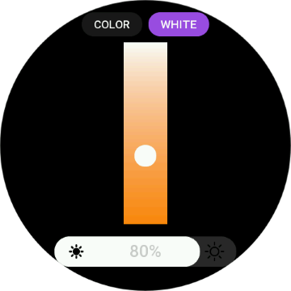
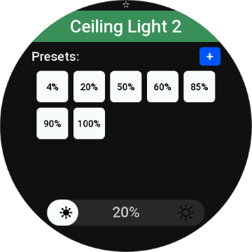
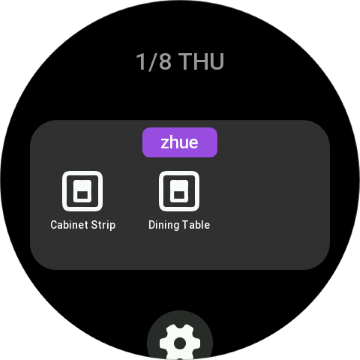
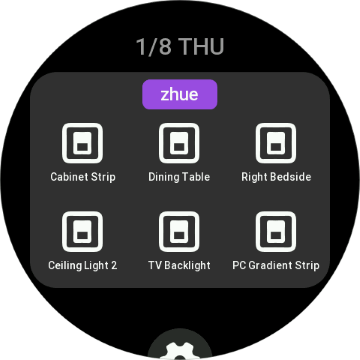
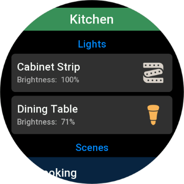

# zhue — Philips Hue on Zepp OS watches

[](LICENCE)
[](https://docs.zepp.com/)
[](#)

Control your Philips Hue lights from a Zepp OS watch: rooms and zones, single
lights, brightness, colors and white temperature, scenes, and a shortcut card
for the lights you use most.

## Screenshots

|  |  |  |
|---|---|---|
|  |  |  |
|  |  |  |

## Features

- **Rooms and zones**: two tabs, each group with its icon and an ON/OFF badge
  that switches the whole group.
- **Lights of a group**: each light with its state and brightness; tap the
  icon to switch it, tap the name to open it. The group's scenes are listed
  too (before or after the lights, as set on the phone).
- **A light**: on/off, a brightness slider, favorite presets (whites,
  temperatures, colors) and a color picker:
  - color: hue across, saturation down, brightness on the slider below;
  - white: temperature from cool to warm.
  The light changes when you lift the finger.
- **Favorite colors**: add the light's current color from its page, delete one
  with a long press; reset them from the phone.
- **Shortcut card**: up to 9 lights on a card in the watch's shortcuts; a tap
  switches the light. On a light's page, long-press SELECT adds or removes it;
  long-press BACK clears the card.
- **Demo mode**: try the app without a bridge (sample rooms, zones, lights
  and scenes).
- **9 languages**: English, Italian, German, Spanish, French, Russian, Korean,
  Simplified and Traditional Chinese.
- Round and square screens.

## Getting started

You need a Philips Hue Bridge on the same network as your phone, and the Zepp
app on the phone (the watch talks to the bridge through it).

1. Open zhue on the watch: it looks for the bridge on your network.
2. When asked, press the round link button on top of the bridge.
3. The watch pairs and shows your rooms. Done: the bridge's address and key
   are kept by the Zepp app.

If the bridge isn't found, check that the phone is on the same network as the
bridge and that the bridge is online, then tap Retry on the watch.

### Settings on the phone

- **Bridge**: whether it's paired, its IP address, its key (shortened), and
  *Clear all configuration* (asks for confirmation) to pair again.
- **On the watch**: the tab the app opens on (Rooms or Zones), whether scenes
  come before or after the lights, whether scenes are shown.
- **Favorite colors**: the current presets, and going back to the defaults.
- **Demo mode**.

## Privacy

- The watch reaches the bridge through the Zepp app on the phone; lights are
  controlled on your local network (Hue API v1).
- To find the bridge, the app asks Philips' discovery service
  (`discovery.meethue.com`) for the bridge's local address. Nothing else
  leaves your network.
- The bridge's key stays in the Zepp app's storage for zhue. The settings page
  shows it shortened, and test builds' logs never contain it.

## Limitations

- Hue API v1 only (the bridge's local REST API); no entertainment areas,
  schedules or automations.
- The bridge is found through Philips' discovery service: the IP address
  field in the settings doesn't replace it for pairing yet.
- Lights of models zhue doesn't know show a generic bulb icon.

## Development

Built with [Zeus CLI](https://docs.zepp.com/docs/guides/tools/cli/) and
[ZML](https://github.com/zepp-health/zml).

```
zhue/
├── app.js                 # app: caches shared by the pages, remote log queue
├── app.json               # targets (round / square), permissions, pages
├── config.js              # build switches: LOG_LEVEL, DEV
├── app-side/              # side service on the phone
│   ├── index.js           # Hue bridge: discovery, pairing, lights, groups, scenes
│   └── log.js             # Logs box store and scrubber
├── page/                  # watch pages (logic + one layout per screen shape)
│   ├── index.js           # start: Bluetooth, bridge search, pairing, first load
│   ├── groups.js          # rooms and zones
│   ├── group-detail.js    # lights and scenes of a group
│   ├── light-detail.js    # one light: switch, brightness, presets
│   ├── color-picker.js    # color and white temperature
│   ├── quick-toggle.js    # switches a light from the shortcut card
│   ├── *.r.layout.js      # round screens
│   ├── *.s.layout.js      # square screens
│   └── i18n/              # watch strings
├── app-widget/            # shortcut card
├── setting/               # settings page in the Zepp app (+ i18n, logo.js)
├── utils/                 # constants (colors, icons, light models), logging, request queue
├── tools/                 # Node scripts for development (.cjs: not bundled)
└── assets/                # images per target (default.r round, default.s square)
```

### Logs for testing

Test builds send the watch's and the phone's log lines to a **Logs** box at
the bottom of the settings page, to copy into a bug report (the bridge key and
addresses are removed). Set the level in `config.js`:

- `LOG_LEVEL = 'trace'` or `'info'` for builds given to testers;
- `LOG_LEVEL = 'off'` for store releases: nothing is logged and the box is
  not shown.

### Tools

- `node tools/check-icon-masks.cjs`: the light and room icons are masks drawn
  over the light's color; Zeus converts each PNG to a palette image, and for
  some icons the mask came out translucent (the color showed through as a
  square). This runs Zeus's own converter on every icon and fails on such a
  mask. Run it after adding or changing an icon.
- `node tools/gen-settings-logo.cjs`: makes `setting/logo.js`, the app icon's
  wordmark for the settings page header. Run it after changing the icon.

Both need `npm install` (they use `@zeppos/zpm`, or Node's own modules).

## Icons attribution

The light and room icons are adapted from **[hass-hue-icons](https://github.com/arallsopp/hass-hue-icons)**
by [arallsopp](https://github.com/arallsopp), licensed under
[CC BY-NC-SA 4.0](https://github.com/arallsopp/hass-hue-icons/blob/main/LICENSE).
Those icons, and any changes to them, stay under that license.

## License

The code is under the MIT License: see [LICENCE](LICENCE). The icons are under
their own license (above).

## Disclaimer

zhue is an independent project, not affiliated with Signify (Philips Hue) or
Zepp Health.
